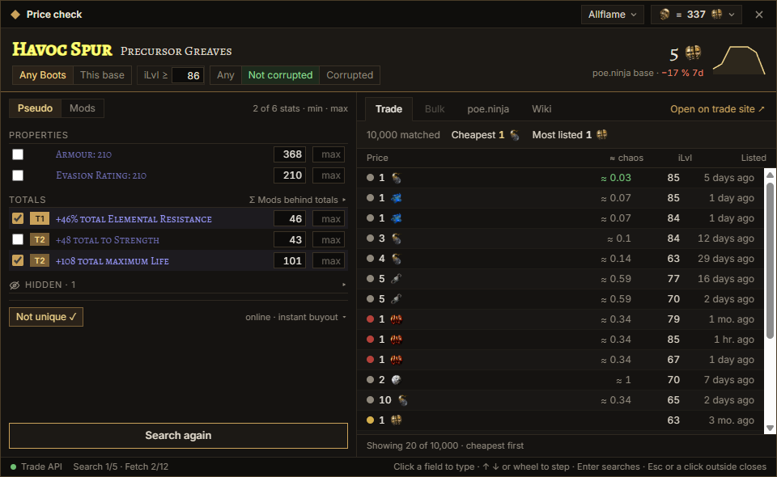
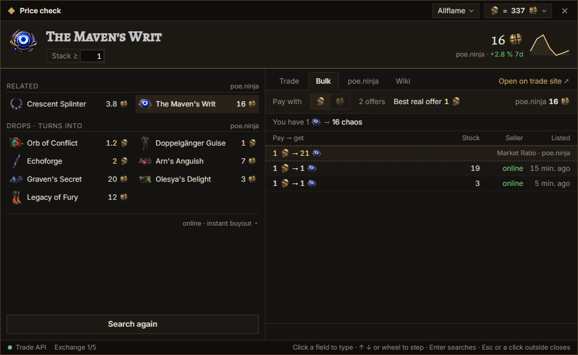
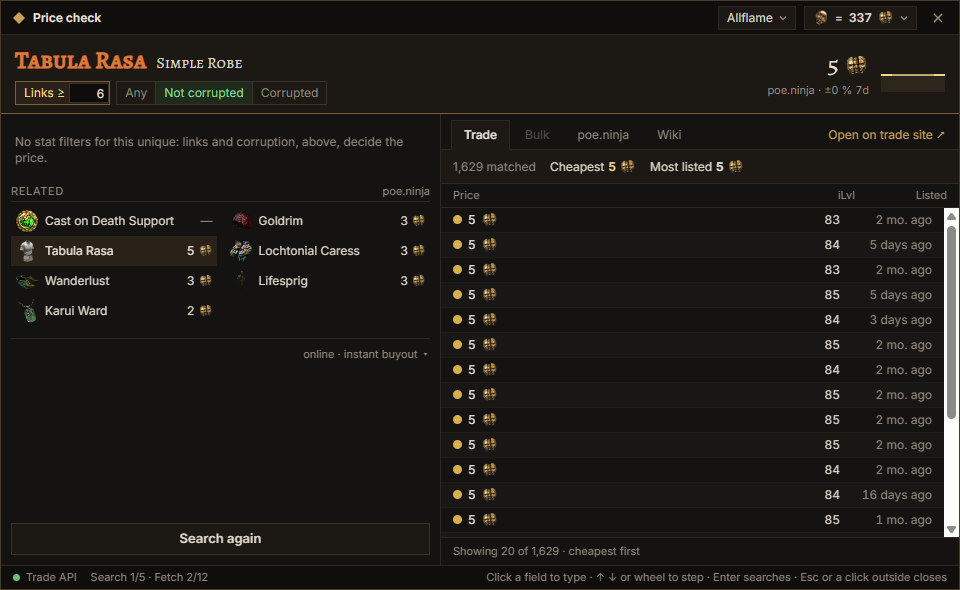
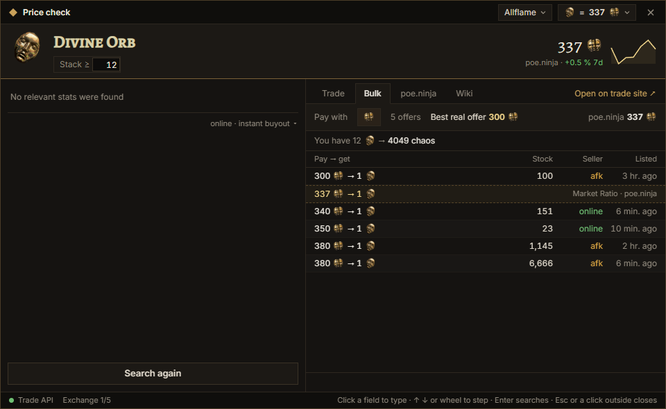
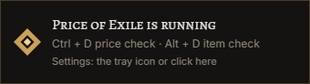

# Price of Exile

A Path of Exile price check overlay for Windows: trade listings, poe.ninja prices, item and map check,
stash search presets and chat commands. Downloads: [Releases](https://github.com/ArtemNA/price-of-exile/releases/latest).

## Screenshots

A rare item: the base, item level and corrupted switches in the header, mods grouped with their tiers,
trade listings with currency icons and the poe.ninja price with its 7 day trend.



Fragments, currency and cards: related items with poe.ninja prices right next to the price, and bulk offers.



A unique: links and corruption decide the price; the set it belongs to is shown alongside.



Bulk exchange with the market ratio from poe.ninja.



The message in the screen corner when the overlay starts:



Two themes ship with the app (ours and Awakened PoE Trade's look, Settings → Overlay → Theme); how to make your own: [THEMING.md](THEMING.md).

This project was generated using [Angular CLI](https://github.com/angular/angular-cli) version 22.2.0.

## Running the app in development

```bash
npm run dev
```

This is `tauri dev` with `src-tauri/tauri.dev.conf.json`: the dev build runs under the identifier
`com.artemna.poe-trade-overlay.dev`, so its settings file, WebView data and logs are separate from an
installed release. A debug build started with the release identifier (plain `tauri dev`) refuses to start.

Testing without the game: run `scripts/fake-game.ps1` and start the app with `POE_GAME_TITLE="PoE Fake Game"`
(and `POE_KEEP_POPUP=1` for screenshots); see the comments in `scripts/`.

## Releases

Push a tag that matches `version` in `src-tauri/tauri.conf.json` (`git tag v0.1.0 && git push origin v0.1.0`):
`.github/workflows/release.yml` builds the NSIS installer and the portable exe, signs the installer for the
updater and publishes the release with `latest.json`, `SHA256SUMS.txt` and notes from `.github/RELEASE_NOTES.md`
plus the tag's section of `CHANGELOG.md` (write it before tagging). The signing key is the repository secret `TAURI_SIGNING_PRIVATE_KEY`; its public half is in
`tauri.conf.json`. Bump `version` in `tauri.conf.json`, `Cargo.toml` and `package.json` together.

## Code scaffolding

Angular CLI includes powerful code scaffolding tools. To generate a new component, run:

```bash
ng generate component component-name
```

For a complete list of available schematics (such as `components`, `directives`, or `pipes`), run:

```bash
ng generate --help
```

## Building

To build the project run:

```bash
ng build
```

This will compile your project and store the build artifacts in the `dist/` directory. By default, the production build optimizes your application for performance and speed.

## Running unit tests

To execute unit tests with the [Vitest](https://vitest.dev/) test runner, use the following command:

```bash
ng test
```

## Running end-to-end tests

For end-to-end (e2e) testing, run:

```bash
ng e2e
```

Angular CLI does not come with an end-to-end testing framework by default. You can choose one that suits your needs.

## Additional Resources

For more information on using the Angular CLI, including detailed command references, visit the [Angular CLI Overview and Command Reference](https://angular.dev/tools/cli) page.
